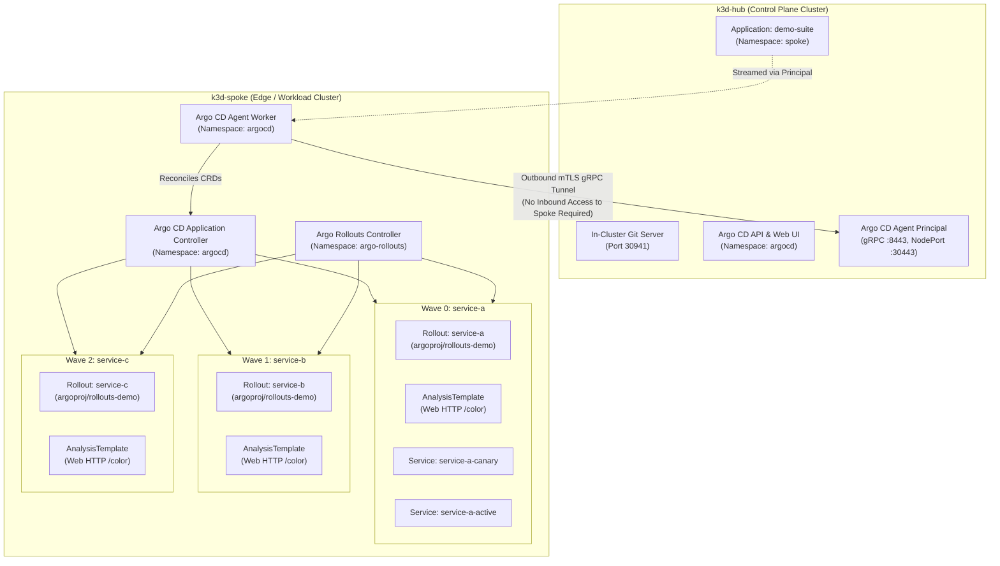

# Argo CD Agent (Managed Mode) & Argo Rollouts Verification Report

## Executive Summary
This report presents the findings, architecture, and live verification results for running **Argo CD Agent in Managed Mode** paired with **Argo Rollouts**. 

The verification environment was deployed across two isolated `k3d` Kubernetes clusters (`k3d-hub` and `k3d-spoke`) communicating over an outbound-only mTLS gRPC connection. We evaluated two critical production concerns:
1. **Rollout Throttling / Blast Radius Control:** Eliminating rollout load spikes by executing rollouts sequentially (1 at a time instead of 20 concurrently).
2. **Rollback & Roll-Forward Reliability:** Comparing **automated analysis-driven aborts** with **manual operator interventions** across the agent boundary, revealing exactly how GitOps self-heal and Rollout controller states interact.

---

## 1. System Architecture



### Verified Multi-Cluster Properties
- **Zero Inbound Credentials:** The Hub cluster holds **no kubeconfig or cluster-admin secrets** for the Spoke cluster.
- **Outbound Tunnel:** The Spoke agent initiates an outbound mTLS gRPC connection to `k3d-hub-serverlb:30443`.
- **Application Distribution:** Creating an `Application` in namespace `spoke` on the Hub triggers the Principal to stream the application down to the Spoke, where the local application controller reconciles it.
- **Status Reporting:** Rollout health (`Healthy`, `Progressing`, `Degraded`) and sync state are streamed back up to the Hub UI and API in real time.

---

## 2. Test Scenarios & Empirical Findings

### Scenario 1: Staggered Wave-Based Roll-Forward (Blast Radius Control)
* **Problem:** In production, triggering updates across 20+ rollouts simultaneously causes thundering herd load spikes on infrastructure and databases.
* **Mechanism Tested:** Argo CD Sync Waves (`argocd.argoproj.io/sync-wave: "0"`, `"1"`, `"2"`) combined with Argo Rollouts Canary steps.
* **Results:**
  ```
  [ 0.3s] Svc-A: Healthy     | Svc-B: Healthy     | Svc-C: Healthy     | Active: 0 | App: Healthy
  [ 3.8s] Svc-A: Progressing | Svc-B: Healthy     | Svc-C: Healthy     | Active: 1 | App: Progressing
  [ 7.4s] Svc-A: Progressing | Svc-B: Healthy     | Svc-C: Healthy     | Active: 1 | App: Progressing
  [12.7s] Svc-A: Healthy     | Svc-B: Progressing | Svc-C: Healthy     | Active: 1 | App: Progressing
  [16.2s] Svc-A: Healthy     | Svc-B: Progressing | Svc-C: Healthy     | Active: 1 | App: Progressing
  [19.9s] Svc-A: Healthy     | Svc-B: Healthy     | Svc-C: Progressing | Active: 1 | App: Progressing
  [28.7s] Svc-A: Healthy     | Svc-B: Healthy     | Svc-C: Healthy     | Active: 0 | App: Healthy
  ```
* **Empirical Verification:**
  - `Max Concurrent Rollouts Observed = 1` (target: 1).
  - Wave 1 (`service-b`) **never started** until Wave 0 (`service-a`) reached `Healthy`.
  - Wave 2 (`service-c`) **never started** until Wave 1 (`service-b`) reached `Healthy`.
  - Peak concurrency was strictly bounded, preventing rollout overload.

---

### Scenario 2: Automated Canary Failure & Rollback
* **Problem:** When canary analysis detects failures, does the rollout cleanly revert traffic, and does Argo CD respect the rollback or loop trying to re-apply the faulty manifest?
* **Mechanism Tested:** Faulty container image `argoproj/rollouts-demo:bad-red` pushed to `service-a`. AnalysisTemplate executes HTTP GET against `/color` on the canary service (which returns `HTTP 500`).
* **Observed Behavior:**
  1. Canary pod deployed and receives 50% traffic.
  2. `AnalysisRun` detects `received non 2xx response code: 500`.
  3. `consecutiveErrorLimit: 1` triggers immediate failure.
  4. Argo Rollouts controller **immediately terminates the canary pod** (`◌ Terminating`).
  5. 100% of traffic is diverted back to the stable ReplicaSet (`green`).
  6. Rollout status transitions to `✖ Degraded`.
  7. Spoke Agent reports status to Hub: Argo CD Application marks `Health: Degraded`.
  8. **Downstream Safety:** Because Wave 0 degraded, Argo CD's sync engine halted immediately. **Services B and C were completely protected and never touched.**

---

### Scenario 3: Manual Operator Abort vs. GitOps Reconciliation
* **Problem:** What happens when an on-call engineer runs an emergency manual abort (`kubectl argo rollouts abort`) while Argo CD has `automated: selfHeal: true` enabled? Does self-heal fight the abort?
* **Mechanism Tested:** Initiated a rollout on `service-b` and executed `kubectl argo rollouts abort service-b`.
* **Key Findings:**
  1. **Self-Heal Does NOT Override Manual Abort:** Argo CD's `selfHeal: true` does **not** revert the manual abort. This is because `abort: true` is stored in the **status subresource** (`status.abort`), not the `spec`. GitOps controllers reconcile declared `spec`, leaving controller runtime status intact.
  2. **The Abort Lock Trap:** When an abort occurs, `status.abort: true` remains on the Rollout. If an engineer simply pushes a new image commit to Git without clearing the abort, Argo CD attempts to sync, but the Rollout remains in `RolloutAborted` state.
  3. **The Argo CD Sync Retry Lock Trap:** If Argo CD's automated sync retry (`retry.limit: 5`) is active during a rollout failure, Argo CD locks onto the specific failing Git commit SHA (`operationState.operation.sync.revision`). Pushing a fix commit to Git will **not** immediately be applied because Argo CD prioritizes finishing the retry backoff sequence of the previous failing commit. Terminating the hung operation (`argocd app terminate-op` or removing `status.operationState` on the Spoke cluster) immediately releases the sync lock.
  4. **The Correct Recovery Workflow:**
     * **Step 1 (Emergency Stop):** `kubectl argo rollouts abort <name>` (instantly routes 100% traffic to stable).
     * **Step 2 (Git Revert):** Commit a Git revert (`git revert`) to align declared desired state with the stable version.
     * **Step 3 (Re-arm Controller):** `kubectl argo rollouts retry rollout <name>` to clear `status.abort`.
     * **Step 4 (Release Sync Lock if needed):** Terminate any active sync retry operation on the Spoke cluster.

---

### Scenario 4: Hub-Controlled Rollout via Argo CD Agent Resource Proxy (Approach C)
* **Problem:** In edge and distributed multi-cluster architectures, the central Hub has **zero direct inbound network access** into spoke clusters (firewalls, private VPCs, NAT). How can operators inspect live manifests, stream pod logs, and trigger manual rollout promotions (e.g. promoting past a `pause: {}` approval gate) directly from the Hub Argo CD UI without drilling inbound firewall holes?
* **Mechanism Tested:**
  1. Configured **Argo CD Agent Resource Proxy** on the Hub (`principal.resourceProxy.enabled: true`, listening on port 9090).
  2. Enabled Resource Proxy client on the Spoke (`enableResourceProxy: true`).
  3. Mapped the Argo CD cluster secret `cluster-spoke` to `https://argocd-agent-resource-proxy:9090?agentName=spoke`.
  4. Introduced a manual approval gate `pause: {}` at Step 1 (30% weight) in `service-a.yaml`.
  5. Pushed an update and watched the Rollout pause on `k3d-spoke`.
  6. From the Hub control plane (via Argo CD API & Web UI on port 8443):
     - Discovered available actions via `/api/v1/applications/demo-suite/resource/actions`.
     - Streamed live canary pod logs via `/api/v1/applications/demo-suite/pods/.../logs`.
     - Executed the imperative `resume` action via `POST /api/v1/applications/demo-suite/resource/actions`.
* **Observed Behavior:**
  1. **CRD Action Discovery:** The Hub API requested available actions for `Rollout: service-a`. The Resource Proxy serialized the request into a gRPC `ResourceRequest` event, routed it down the reverse tunnel to `k3d-spoke`, executed it against the local API, and returned:
     ```json
     ["restart", "resume", "retry", "skip-current-step", "abort", "pause", "promote-full"]
     ```
  2. **Live Log Streaming:** The Hub Argo CD server successfully opened a live log stream directly from the remote canary pod `service-a-d8c5bf57f-zqmjt` on `k3d-spoke` through the reverse tunnel.
  3. **Imperative Promotion Execution:** The Hub operator sent an imperative `resume` command over the tunnel. The Rollout immediately transitioned from Step 1 (30%) to Step 2 (60%), waited 5s, completed analysis checks successfully, and reached 100% `Healthy`.
  4. **Security & Topology:** Zero inbound ports or load balancers were opened on `k3d-spoke`. All communication remained strictly over the single outbound mTLS gRPC connection established by the spoke agent.

---

## 3. Comparison: Automated Analysis vs. Resource Proxy vs. Manual Spoke CLI

| Dimension | Automated (AnalysisTemplate) | Hub Resource Proxy (Approach C) | Direct Spoke Access (`kubectl`) |
| :--- | :--- | :--- | :--- |
| **Control Plane** | Fully Autonomous | Central Hub UI & API | Local Spoke Cluster |
| **Network Path** | Local on Spoke | Outbound-only reverse gRPC tunnel | Inbound VPN / bastion / NodePort |
| **Approval Gates** | Time-based or metric-based | Human operator via Hub UI/API | Human operator via spoke CLI |
| **Live Visibility** | Streamed metrics | Full manifests & live pod logs | Direct `kubectl` logs |
| **Inbound Firewall Holes** | None | **None (Zero Inbound)** | Required (VPC peering / ingress) |
| **Blast Radius** | Bounded by sync waves | Bounded by manual gates + waves | Manual cluster-by-cluster |
| **Recovery Mechanism** | Git revert or roll-forward | Hub UI "Abort" + Git revert | Spoke CLI abort + Git revert |

---

## 4. Key Production Recommendations

1. **Configure `consecutiveErrorLimit` in Web Analysis:**
   Always specify `consecutiveErrorLimit: 1` or `2` in `AnalysisTemplate`. The default is 4 with 10-second exponential backoffs, which can delay aborts by 40+ seconds.
2. **Use Sync Waves for Multi-Service Deployments:**
   Assign staggered sync waves (`argocd.argoproj.io/sync-wave: "0"`, `"1"`, `"2"`) across interdependent services. Because Argo CD respects the built-in health check of `argoproj.io/Rollout`, Wave N+1 will never progress while Wave N is canaried (`Progressing`) or failed (`Degraded`).
3. **Managed Mode Principal Configuration:**
   When running `argocd-agent` in Managed Mode with namespace-based mapping, configure `principal.allowedNamespaces: "*"` on the Principal Helm release. Otherwise, the Principal will only watch the `argocd` namespace and will ignore applications in agent-specific namespaces.
4. **Deploy Both Redis Proxy AND Resource Proxy:**
   - **Redis Proxy (`:6379`):** Required for the Argo CD Hub UI to read resource trees and application caches from spoke Redis. Point `argocd-cmd-params-cm` to `argocd-agent-redis-proxy:6379`.
   - **Resource Proxy (`:9090`):** Required for live manifests, pod logs, and imperative actions (Promote/Resume/Abort). Point the cluster secret (`cluster-spoke`) to `https://argocd-agent-resource-proxy:9090?agentName=spoke`.
5. **The Argo CD Sync Retry Lock Trap:**
   When an automated sync fails and is actively retrying in the background (`retrying attempt #2`), Argo CD locks the application against new Git revisions or rollbacks. Terminate the active operation (`kubectl patch app demo-suite -n spoke --type json -p '[{"op": "remove", "path": "/operation"}]'`) to immediately release the lock.
6. **GitOps Roll-Forward Discipline:**
   Never assume that simply committing a new image to Git will clear an aborted rollout. In production pipelines, include an automated check to verify whether `status.abort` is true and call `kubectl argo rollouts retry` as part of the promotion pipeline.

---

## 5. Repository File Structure

```
/home/johannes/code/k8s-pro/
├── charts/
│   ├── argocd-agent-principal/       # Principal Helm chart
│   ├── argocd-agent-agent/           # Agent worker Helm chart
│   ├── principal-values.yaml         # Values with mTLS & allowedNamespaces: *
│   └── agent-values.yaml             # Values with managed mode & outbound gRPC
├── git-server/
│   └── deployment.yaml               # In-cluster bare Git daemon (port 30941)
├── gitops-repo/                      # Live GitOps repo synced to git-server
│   ├── kustomization.yaml
│   └── services/
│       ├── service-a.yaml            # Wave 0 Canary + AnalysisTemplate
│       ├── service-b.yaml            # Wave 1 Canary + AnalysisTemplate
│       └── service-c.yaml            # Wave 2 Canary + AnalysisTemplate
├── scripts/
│   ├── setup_clusters.sh             # Provisions k3d-hub and k3d-spoke
│   └── teardown.sh                   # Clean cluster teardown
└── verify_rollouts.py                # Automated end-to-end test runner
```
